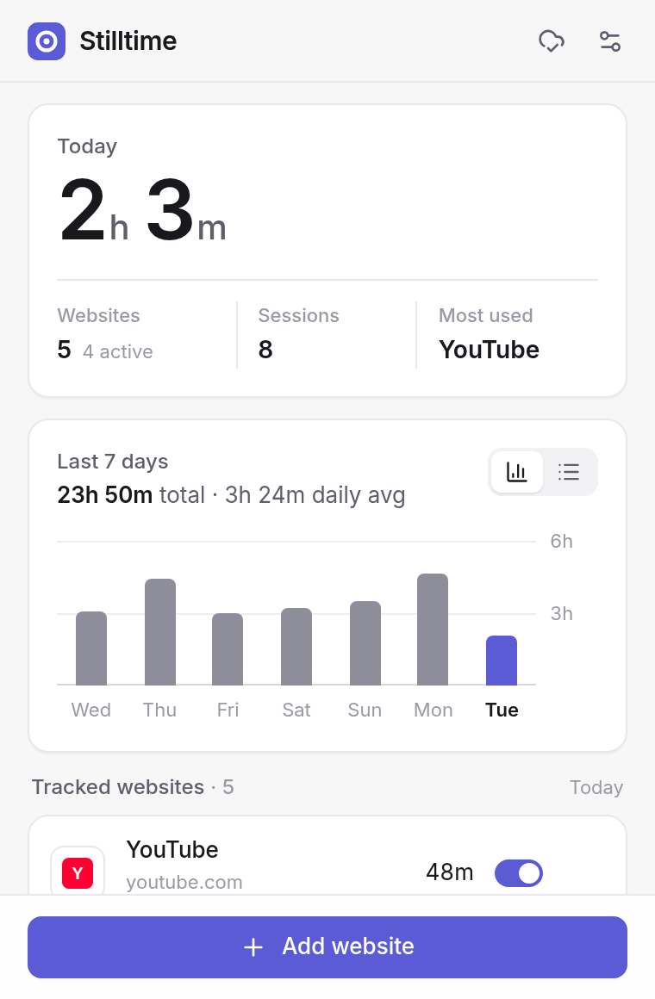
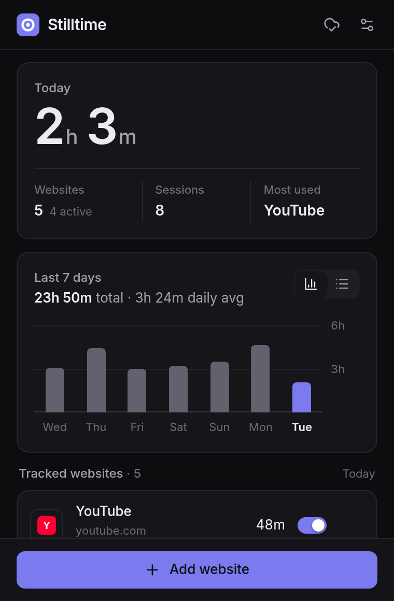
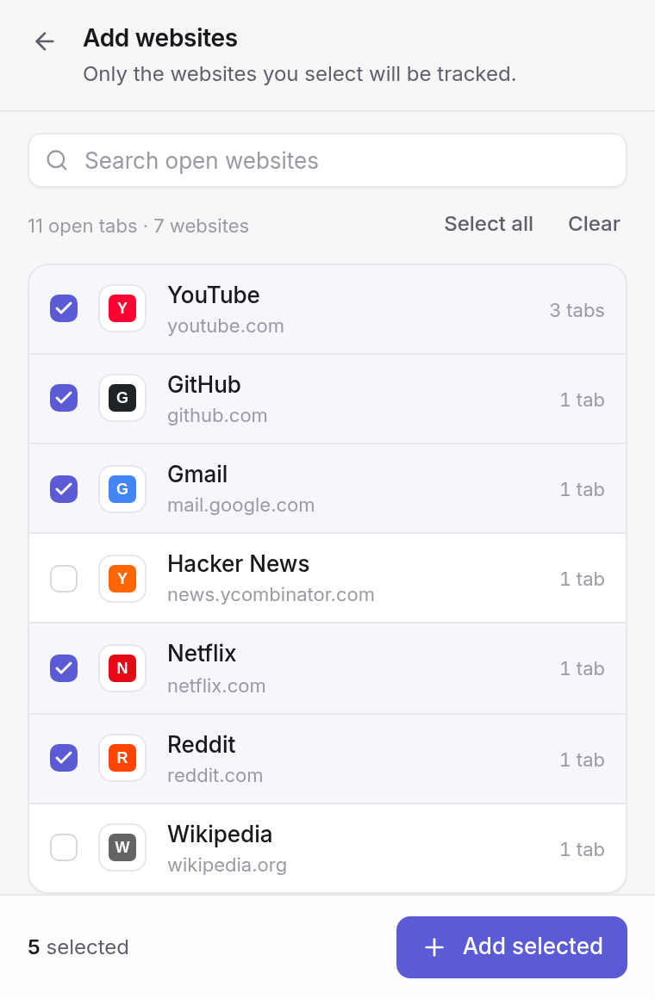
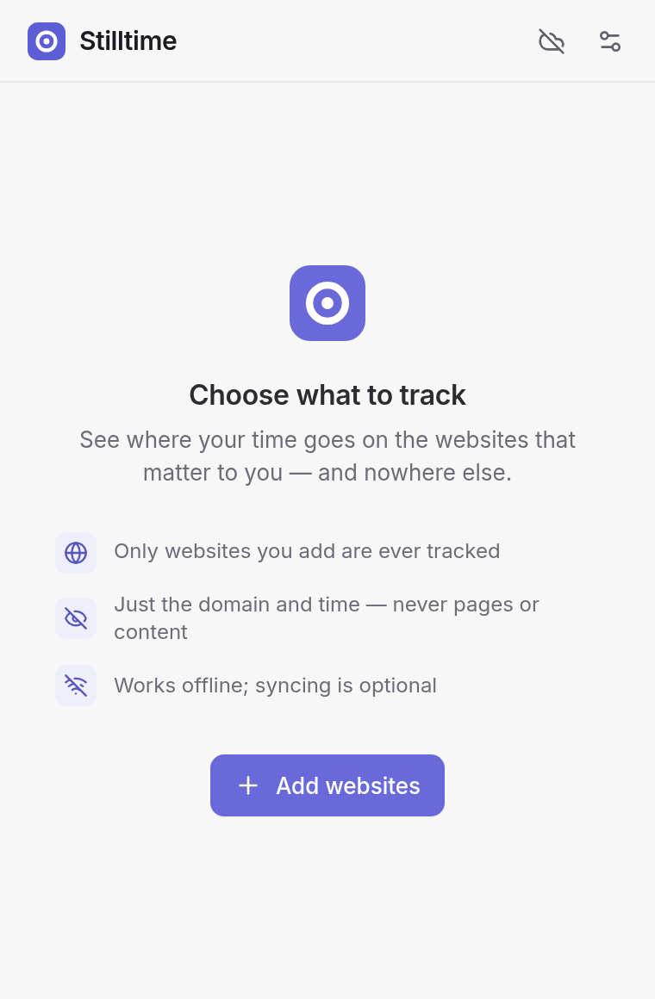
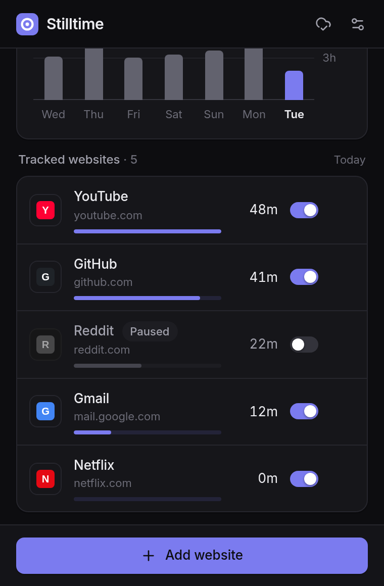
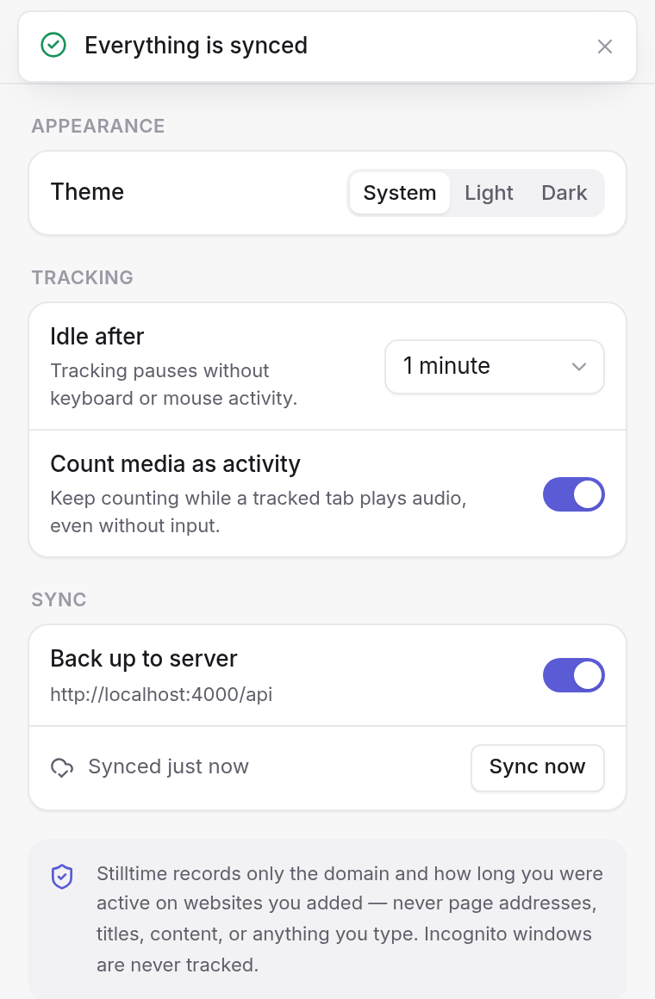

# Stilltime — digital wellbeing for the websites you choose

Stilltime is an **opt-in** Chrome extension that measures how much time you actively spend on the
websites *you* add — and nothing else. It records only a website's domain and how long you were
active on it, works fully offline, and can back your data up to a small Node.js + MongoDB API.

> Phase 1: website registry, add-from-open-tabs flow, reliable MV3 tracking engine, local
> persistence with offline-first sync, daily and weekly statistics.

| Dashboard (light) | Dashboard (dark) | Add websites |
| :---: | :---: | :---: |
|  |  |  |

| First run | Tracked websites | Settings |
| :---: | :---: | :---: |
|  |  |  |

---

## Contents

1. [Quick start](#quick-start)
2. [Repository layout](#repository-layout)
3. [How tracking works](#how-tracking-works)
4. [Website identity (domain normalization)](#website-identity)
5. [Storage and offline-first sync](#storage-and-offline-first-sync)
6. [Permissions](#permissions)
7. [Privacy](#privacy)
8. [Backend API](#backend-api)
9. [Configuration](#configuration)
10. [Testing](#testing)
11. [Limitations and trade-offs](#limitations-and-trade-offs)

---

## Quick start

**Prerequisites:** Node.js ≥ 22.12 (see `.nvmrc`), npm ≥ 10, Chrome ≥ 120, and MongoDB — either
Docker *or* nothing at all (the repo can run a local MongoDB for you).

```bash
npm install                       # installs all workspaces (also downloads a MongoDB binary for tests)
cp .env.example .env              # one .env at the repo root configures both apps
```

### 1. Start MongoDB (pick one)

```bash
docker compose up -d mongo        # MongoDB 8 on 127.0.0.1:27017, data in a Docker volume
# or, without Docker:
npm run db:memory                 # local mongod on 127.0.0.1:27017, data in apps/backend/.data/
```

### 2. Start the API

```bash
npm run dev:backend               # http://localhost:4000/api — check http://localhost:4000/api/health
```

### 3. Build and load the extension

```bash
npm run build -w @stilltime/extension      # production build → apps/extension/dist
# or, while developing:
npm run dev:extension                      # rebuilds dist/ on every change (development mode)
```

1. Open `chrome://extensions` and enable **Developer mode**.
2. Click **Load unpacked** and select `apps/extension/dist`.
3. Pin Stilltime, open a few websites in tabs, click the icon → **Add websites**.

After a rebuild in `dev:extension` mode, press the reload icon on the extension's card (the popup
picks up changes the next time it opens).

### Useful scripts (repository root)

| Command | What it does |
| --- | --- |
| `npm run verify` | Type-check all workspaces, run all unit/integration tests, build everything |
| `npm test` | Unit + integration tests (shared, backend with a real mongod, extension) |
| `npm run test:e2e` | Builds everything, then drives real Chrome with the built extension against the built API |
| `npm run typecheck` | Strict TypeScript (TS 7) for every workspace |
| `npm run build` | Builds shared → backend (`apps/backend/dist`) → extension (`apps/extension/dist`) |

---

## Repository layout

```
├── apps/
│   ├── extension/                 Chrome extension (MV3, React 19, Vite 8, Tailwind 4)
│   │   ├── manifest.json          Source manifest (version + API host permission injected at build)
│   │   ├── src/background/        Service worker: the only writer of extension state
│   │   │   ├── service-worker.ts    Event wiring (all listeners registered at top level)
│   │   │   ├── tracking-engine.ts   Tracking rules + reconcile loop
│   │   │   ├── session-manager.ts   Pure session lifecycle (start/extend/finish/split/recover)
│   │   │   ├── tab-manager.ts       Observes focus, active tab, audio and idle state
│   │   │   ├── message-router.ts    Validated requests from the popup
│   │   │   ├── website-registry.ts  Pure registry operations (add/remove/toggle/settings)
│   │   │   └── alarms.ts            Heartbeat + sync alarms
│   │   ├── src/services/          Storage, IndexedDB session store, sync manager, API client,
│   │   │                          tab grouping, stats, messaging
│   │   ├── src/pages/             Dashboard, Add websites, Settings
│   │   ├── src/components/        Product components + ui/ design-system primitives
│   │   ├── test/                  Unit tests (Vitest, fake-indexeddb)
│   │   └── e2e/                   End-to-end tests (real Chrome via puppeteer-core)
│   └── backend/                   REST API (Express 5, Mongoose 9, Zod 4, pino)
│       ├── src/{config,auth,middleware,models,validators,services,controllers,routes}
│       ├── test/                  Integration tests (supertest + MongoMemoryServer)
│       └── scripts/memory-db.ts   Local MongoDB without Docker
├── packages/shared/               Types, constants, domain normalization, date helpers
│                                  (used by both apps — one definition of "a website")
├── docs/screenshots/
├── docker-compose.yml
└── .env.example
```

---

## How tracking works

### Rules

A website accumulates time only while **all** of these hold:

1. It is in your tracked list **and** tracking is enabled for it.
2. It is the **active tab** of the **focused** Chrome window.
3. You are **not idle** (no keyboard/mouse input for the idle threshold, 60 s by default) and the
   screen is **not locked**.
   *Exception (on by default, configurable):* if the active tracked tab is **playing audio**, idle
   time still counts — watching a video produces no input, and `chrome.idle` cannot tell it apart
   from being away. A locked screen always stops tracking.
4. The tab is not incognito (the extension is also declared `"incognito": "not_allowed"`).

Opening Stilltime's own toolbar popup does **not** pause the current session.

### A reconciler, not an event counter

Every relevant event — `tabs.onActivated/onUpdated/onRemoved/onReplaced`,
`windows.onFocusChanged`, `idle.onStateChanged`, the heartbeat alarm, registry or settings changes,
worker start-up — triggers the same `reconcile()`:

1. read the persisted active session, the registry and settings;
2. **observe the real browser state** (focused window, its active tab, audio, idle state) instead
   of trusting the event payload — this makes the engine immune to out-of-order events and to the
   Linux quirk where focus briefly reports "no window" while moving between Chrome windows;
3. decide what should be tracked right now (`resolveTrackingTarget`);
4. apply the difference (`planTransition`) to the persisted session **in one IndexedDB
   transaction**.

Reconciliations run through a serial queue, so concurrent events can never create duplicate or
overlapping sessions. Durations are always computed from timestamps — nothing increments a counter
or relies on `setInterval`.

### Surviving Manifest V3

The service worker may be suspended at any moment, so it holds no meaningful state in memory:

- **Heartbeat.** While a session is active, a `chrome.alarms` alarm (every 30 s, Chrome's minimum)
  wakes the worker to re-check and checkpoint the session's `lastSeenAt`.
- **Unobserved gaps are never counted.** If more than 90 s pass between two confirmations — the
  computer slept, Chrome was closed or crashed, the clock jumped back — the session is closed at
  its **last confirmed moment** with status `recovered`, and a new session starts if appropriate.
  At most one heartbeat interval of real usage can be lost; downtime is never counted.
- **Recovery on every start.** Each worker start re-applies the idle threshold and reconciles,
  which closes anything left open by a crash.
- Sessions shorter than 1 s (cycling through tabs) are discarded as noise.

### Sessions

| Field | Notes |
| --- | --- |
| `id` | Random UUID generated when the session starts — the sync idempotency key |
| `domain`, `websiteName` | Canonical website key and display name |
| `startedAt`, `endedAt`, `durationSeconds` | Timestamps; duration derived from them |
| `date` | Local calendar day. Sessions **never span midnight**: they are split at local midnight (DST-safe), later parts get deterministic ids (`<id>:<date>`) |
| `status` | `completed` (ended by an observed event) or `recovered` (closed at its last confirmation after an unobserved gap) |

---

## Website identity

Tabs and tracked websites are reduced to one canonical key by `packages/shared/src/domain`, shared
by the extension and the API:

| Input | Website |
| --- | --- |
| `www.youtube.com`, `m.youtube.com`, `youtube.com/watch?v=…` | `youtube.com` |
| `old.reddit.com`, `en.m.wikipedia.org` | `reddit.com`, `wikipedia.org` |
| `www.bbc.co.uk` | `bbc.co.uk` (multi-label public suffix via the Public Suffix List) |
| `mail.google.com`, `docs.google.com`, `www.google.com` | three different websites |
| `alice.github.io`, `bob.github.io` | two different websites (private PSL suffixes are honoured) |
| `localhost:3000`, `192.168.1.10` | the host itself |
| `chrome://…`, `chrome-extension://…`, `edge://…`, `about:`, `javascript:`, `data:`, `file:` | never a website |

By default a website is its **registrable domain** (eTLD+1, via [`tldts`](https://github.com/remusao/tldts)),
which folds mirrors and sections of one site together and closes "use the mobile site" loopholes. A
short allow-list of platforms that host unrelated products on subdomains (`google.com`,
`amazon.com`, `apple.com`, `microsoft.com`, `yahoo.com`, …) keeps the first-level service
subdomain instead. The server re-normalizes every domain it receives.

---

## Storage and offline-first sync

| Where | What |
| --- | --- |
| `chrome.storage.local` | Configuration: tracked-website registry, settings, sync status, installation id |
| IndexedDB (`stilltime`) | Usage: finished sessions (indexed by date and sync state) and the active-session checkpoint |
| MongoDB (optional) | A replica: `TrackedWebsite`, `WebsiteSession` (source of truth), `DailyUsage` (rollup cache) |

**The service worker is the single writer.** The popup reads storage/IndexedDB directly but every
change goes through a typed message (`websites/add`, `websites/remove`, `websites/set-enabled`,
`settings/update`, `sync/run`, `tracking/refresh`). The worker persists before it replies, so the
UI never reports a change that was not saved.

**Sync queue.** It is derived from durable state, so it survives restarts by construction:

- websites whose latest change has not been acknowledged (`syncedAt !== updatedAt`, including
  removal tombstones) → `POST /api/websites/sync`, resolved **last-write-wins** on a per-website
  version that only ever increases;
- sessions with `syncState: "pending"` → `POST /api/sessions/sync` in batches of 200.

**Duplicate prevention** happens on both sides: session ids and `(user, domain)` are unique keys in
MongoDB, inserts use `$setOnInsert`, and the client only marks items synced when the server
acknowledges them (`accepted`/`duplicates`). Invalid items are `rejected` once and never retried.

**Retries.** Network, timeout and 5xx/429 failures keep everything pending and schedule the next
attempt with exponential backoff (30 s → 30 min, ±20 % jitter) on a `chrome.alarms` alarm. Finished
sessions are uploaded about a minute after they end (batched). Configuration changes sync
immediately. **Settings → Sync now** ignores backoff. Switching to a different server re-uploads
everything (safe, because uploads are idempotent).

**Sync status** (`idle`, `syncing`, `offline`, `error`, `unauthorized`, `disabled`, pending counts,
last success) is shown in the header and in Settings.

Statistics in the popup are computed locally (instant and offline). The API exposes the same
analytics for other clients.

---

## Permissions

| Permission | Why it is needed |
| --- | --- |
| `tabs` | Read the URL, title and favicon of open tabs (Add websites screen) and the URL of the active tab (tracking). Chrome shows this as *"Read your browsing history"*. Stilltime only derives a domain from URLs; it never stores URLs, titles or history. `activeTab` is insufficient (it only grants access after a click), and host permissions would be far broader. |
| `idle` | Detect inactivity and a locked screen so idle time is not counted. |
| `alarms` | Heartbeat checkpoints while a session is active (MV3 workers are suspended), and scheduled sync retries. |
| `storage` | `chrome.storage.local` for configuration. (IndexedDB needs no permission.) |
| Host permission for the API origin only | Generated at build time from `VITE_API_BASE_URL` (default `http://localhost:4000/*`). Lets the worker reach **your sync server** — it grants no access to any website. |

No content scripts, no `<all_urls>`, no `history`, `webNavigation`, `cookies` or `scripting`.
The extension cannot read page content.

---

## Privacy

Stored: the domain of websites you added, their display name and favicon URL, whether tracking is
enabled, and session timestamps/durations for those domains.

Never stored or sent: full URLs, paths, query strings, page titles, page content, search queries,
messages, cookies, passwords or form data, browsing history of websites you did not add, and
anything from incognito windows. Requests to the API omit cookies (`credentials: "omit"`), and
favicons are loaded with `referrerpolicy="no-referrer"`. Syncing is optional (**Settings → Back up
to server**); with it off, nothing leaves the device.

---

## Backend API

Base URL `http://localhost:4000/api`. Every response uses one envelope:

```jsonc
{ "success": true, "data": { … } }
{ "success": false, "error": { "code": "VALIDATION_ERROR", "message": "…", "details": [ { "path": "domain", "message": "…" } ] } }
```

Error codes: `BAD_REQUEST`, `VALIDATION_ERROR` (400), `UNAUTHORIZED` (401), `NOT_FOUND` (404),
`CONFLICT` (409), `PAYLOAD_TOO_LARGE` (413), `SERVICE_UNAVAILABLE` (503, e.g. database down),
`INTERNAL_ERROR` (500).

| Method & path | Description |
| --- | --- |
| `GET /health` | Liveness + database state (public) |
| `GET /websites?enabled=true\|false` | The caller's tracked websites |
| `POST /websites` | Track a website: `{ domain, displayName?, faviconUrl?, isEnabled? }` — domain is normalized; `409` if already tracked; re-adding a removed website restores it |
| `PATCH /websites/:id` | Update `displayName`, `faviconUrl`, `isEnabled` |
| `DELETE /websites/:id` | Soft delete (sessions are kept) |
| `POST /websites/sync` | Offline-first batch upsert/delete by domain, last write wins → `{ results: [{ domain, status: applied\|stale\|rejected }] }` |
| `POST /sessions` | Store one finished session (idempotent: `201` new, `200` existing) |
| `POST /sessions/sync` | Batch of ≤ 200 sessions → `{ accepted, duplicates, rejected }` |
| `GET /sessions?from&to&domain&limit&before` | Recent-first list with cursor pagination (`nextBefore`) |
| `GET /sessions/today?date\|tz` | Sessions of one calendar day |
| `GET /analytics/today?date\|tz` | Total, sessions, most-used website, per-website breakdown |
| `GET /analytics/weekly?endDate&tz` | Seven zero-filled daily totals + total and average |
| `GET /analytics/websites?from&to&tz` | Per-website totals over a range (default: last 7 days) |

Dates are the **client's** calendar days (`YYYY-MM-DD`): pass `date` explicitly, or `tz` (IANA,
e.g. `Asia/Kolkata`) to let the server derive "today". Uploaded sessions are validated for
consistency (duration matches the timestamps, not in the future, `date` plausible for `startedAt`).

```bash
curl -s localhost:4000/api/analytics/today?tz=Europe/Paris | jq
curl -s -X POST localhost:4000/api/websites -H 'content-type: application/json' -d '{"domain":"www.YouTube.com"}'
```

**Data model.** `TrackedWebsite` (unique `userId + domain`, soft delete, LWW version),
`WebsiteSession` (unique `userId + clientSessionId`; indexes on `userId + date`,
`userId + domain + date`, `userId + startedAt`), `DailyUsage` (unique `userId + date`, recomputed
from sessions after every upload — sessions stay the source of truth).

**Authentication.** Requests pass through a pluggable `AuthStrategy` (`src/auth`). Phase 1 ships a
development strategy that attributes every request to `DEV_USER_ID` — only when
`AUTH_MODE=development`, and refused when `NODE_ENV=production`. With no strategy configured, every
`/api` route except `/health` answers `401` (fail closed). `userId` is an opaque string, so adding
JWT/OIDC or API keys later means adding a strategy — no schema change.

---

## Configuration

One `.env` at the repository root (copy `.env.example`). Real environment variables win.

| Variable | Default | Used by |
| --- | --- | --- |
| `NODE_ENV` | `development` | API (`development` \| `test` \| `production`) |
| `HOST` / `PORT` | `127.0.0.1` / `4000` | API |
| `MONGODB_URI` | — (required) | API, e.g. `mongodb://127.0.0.1:27017/stilltime` |
| `AUTH_MODE` | unset (fail closed) | API — `development` enables the dev user |
| `DEV_USER_ID` | — | API — required with `AUTH_MODE=development` |
| `CORS_ORIGINS` | empty | API — comma-separated origins; `chrome-extension://*` allows any extension (development) |
| `LOG_LEVEL` | `info` | API (pino) |
| `VITE_API_BASE_URL` | `http://localhost:4000/api` | Extension build — default sync server and its host permission |

The extension's server URL can also be changed at runtime (`settings.apiBaseUrl`); a server other
than the build-time one must allow the extension's origin via CORS.

---

## Testing

| Suite | Command | Covers |
| --- | --- | --- |
| Shared (79) | `npm test -w @stilltime/shared` | Domain normalization (public suffixes, aliases, multi-service domains, IDN, IPs, unsupported schemes), display names, DST-safe date math |
| Backend (48) | `npm test -w @stilltime/backend` | Every endpoint against a real `mongod`: validation, 409/404/400/401/503, user isolation, LWW website sync, idempotent and concurrent session uploads, DailyUsage rollups, analytics |
| Extension (127) | `npm test -w @stilltime/extension` | Tab grouping, search and selection (incl. closed tabs), duplicate detection, registry ops, message router (persist-before-success, storage failures, concurrent adds), session lifecycle and durations, tracking rules (focus, idle, media, lock, disable/remove, incognito), sleep/crash/suspension recovery, midnight splits, clock jumps, concurrency, IndexedDB store, API client errors, sync batching/backoff/retry/deduplication/offline/server switch |
| End to end (8) | `npm run test:e2e` | Production builds in real Chrome + the built API + MongoDB: onboarding, grouping and "Already added", real tracking durations, SPA navigation, sync with server-side totals equal to local ones, no duplicates on re-sync, removal stops tracking |

Extension tests run in `America/New_York` so day-boundary tests cross real DST transitions. The
e2e suite finds Chrome automatically (`CHROME_PATH` overrides) and is skipped when none is
installed. It loads the extension through the DevTools protocol because Chrome 137+ ignores
`--load-extension` in branded builds.

---

## Limitations and trade-offs

- **`tabs` warning.** Reading tab URLs requires the `tabs` permission, which Chrome describes as
  "Read your browsing history". There is no narrower API for continuous, opt-in, cross-tab tracking.
- **Idle is input-based.** `chrome.idle` only knows about keyboard/mouse input. Audible media is
  treated as activity (configurable); a **muted** video without input stops counting after the
  idle threshold. Reading without touching the mouse for longer than the threshold also pauses
  tracking. The threshold period itself counts as active time.
- **Checkpoint granularity.** After a crash, sleep or forced shutdown, up to ~30 s (one heartbeat)
  of the last session may be lost — by design: unobserved time is never counted.
- **Focus quirks.** Some Linux window managers emit spurious focus changes; a 250 ms settle window
  absorbs the common case. Picture-in-picture windows and unfocused windows are not tracked.
- **Phase 1 is single-device first.** Website edits resolve last-write-wins using client clocks;
  the extension does not yet pull server state, so two devices are not reconciled into one view.
- **Authentication.** Only the development strategy exists; a production deployment needs a real
  strategy (the hook and data model are in place).
- **`DailyUsage` is a cache.** Under concurrent uploads for the same day it can briefly lag; it is
  recomputed from sessions on the next upload.
- **Local history is not pruned** yet. Storage cost is small (~200 bytes per session).
- **Display names** come from a curated list or the domain (e.g. *Example* for `example.co.uk`);
  renaming in the UI is not implemented yet.
- **Server URL at runtime.** The host permission is generated from the build-time API URL. A
  different server works only if its CORS settings allow the extension origin.
